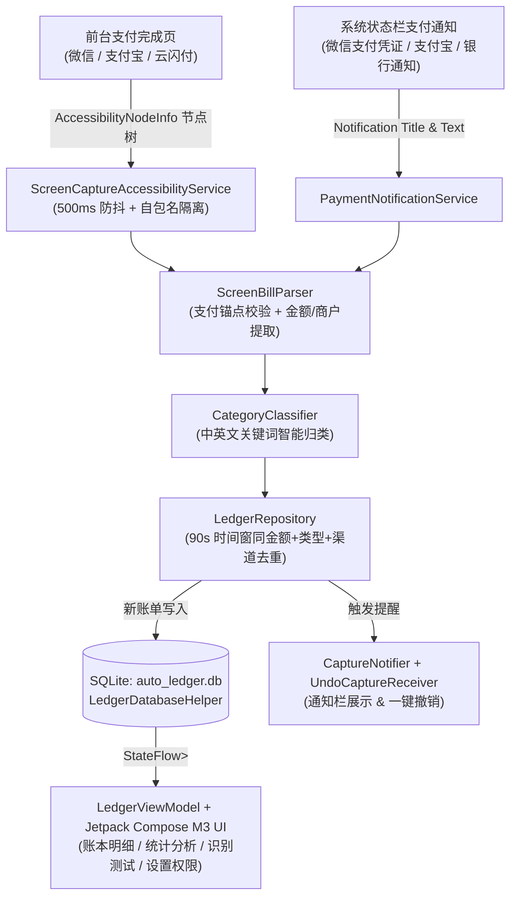

# 自动记账 (AutoLedger) — Android 基于屏幕无障碍识别的本地自动记账应用

**自动记账 (AutoLedger)** 是一款面向 Android 平台（`minSdk 26` / Android 8.0+）的**零联网、纯本地隐私优先**自动记账应用。它通过 Android 原生 `AccessibilityService`（无障碍窗口节点树提取）与 `NotificationListenerService`（支付通知双通道兜底）协同工作，在微信支付、支付宝、云闪付及银行 App 出现交易完成界面时，自动提取**交易金额、收款商户、收支方向与支付渠道**，智能归类写入本地 SQLite 账本，并弹出带**「撤销该笔」**按钮的通知提醒。

---

## 一、核心产品特性

1. **屏幕无障碍节点实时识别（核心通道）**
   - 基于 `ScreenCaptureAccessibilityService` 监听前台窗口状态与内容变化（带 ~500ms 防抖保护），遍历 `AccessibilityNodeInfo` 文本树提取真实支付完成页信息。
   - **严格防误触机制**：内置交易完成锚点校验（如微信 `支付成功 / 付款成功 / 退款到账`、支付宝 `付款成功 / 交易成功 / 账单详情`），**自动过滤普通微信聊天带数字消息、公众号文章与钱包余额页**，并自动跳过 `com.cooper.autoledger` 自身包名防止递归自触发。
2. **支付通知辅助监听 + 90 秒指纹智能去重（双通道协同）**
   - `PaymentNotificationService` 监听微信支付凭证、支付宝交易提醒与银行动账通知，解决快速锁屏或秒退支付结果页导致的漏记。
   - `LedgerRepository.insertFromParsedIfNotDuplicate` 基于 `amountCents + type + channel` 计算摘要并在 **90 秒时间窗**内执行原子查重：即使同一笔消费先后触发「屏幕识别」与「通知栏推送」，也只会入账唯一一笔。
3. **智能商户语义分类引擎**
   - `CategoryClassifier` 内置丰富中英文商户与场景关键词库，自动映射至餐饮美食、交通出行、购物消费、日用生鲜、休闲娱乐、居家生活、医疗健康、转账红包、工资收入、退款红包等 12 个标准分类。
4. **通知栏一键撤销 + 完整手动增删改查**
   - 每次自动捕获成功后通过 `CaptureNotifier` 发送高优先级横幅通知，支持通知栏直接点击**「撤销该笔」**（由 `UndoCaptureReceiver` 精准删除对应记录）。
   - 支持按月切换账本、按日分组统计小计、手动补记账单、点击任意账单修改分类/金额/渠道/商户/备注或删除记录。
5. **原生 Compose Canvas 可视化图表 & 内置屏幕识别测试台**
   - 零第三方图表库依赖，使用 Jetpack Compose `Canvas` 原生绘制**分类占比环形图 (Donut Chart)** 与**近 7 日收支趋势柱状图 (Bar Chart)**。
   - 内置**「屏幕识别测试台」** Tab：无需真实扫码花钱，一键加载「微信支付成功页」「支付宝账单页」「退款入账页」「微信聊天防误触测试」4 组真实节点树，实时预览解析结果并模拟自动入账。
6. **100% 离线本地隐私安全 & CSV 导出**
   - `AndroidManifest.xml` **不申请 `INTERNET` 网络权限**；所有识别逻辑与 SQLite 数据库 (`auto_ledger.db`) 100% 运行在手机本地，支持一键导出 UTF-8 CSV 账单文件。

---

## 二、系统架构与目录结构



### 代码包结构 (`com.cooper.autoledger`)

```text
auto-ledger/
├── app/
│   ├── build.gradle.kts
│   └── src/
│       ├── main/
│       │   ├── AndroidManifest.xml
│       │   ├── res/xml/accessibility_service_config.xml
│       │   └── java/com/cooper/autoledger/
│       │       ├── MainActivity.kt                         # 单 Activity + 4-Tab M3 导航宿主
│       │       ├── model/                                  # 领域模型与金额工具
│       │       │   ├── TransactionType.kt                  # EXPENSE / INCOME
│       │       │   ├── Category.kt                         # 12 类标准收支分类
│       │       │   ├── PaymentChannel.kt                   # 微信 / 支付宝 / 云闪付 / 手动 / 其他
│       │       │   ├── BillRecord.kt                       # 持久化账单实体
│       │       │   ├── ParsedScreenBill.kt                 # 屏幕/通知解析中间结果
│       │       │   └── CurrencyUtils.kt                    # 分(Long) <-> 元(String) 精确转换
│       │       ├── data/                                   # SQLite 持久化与响应式仓库
│       │       │   ├── LedgerDatabaseHelper.kt             # 原生 SQLiteOpenHelper
│       │       │   └── LedgerRepository.kt                 # StateFlow 数据源 + 90s 去重 + CSV 导出
│       │       ├── capture/                                # 屏幕捕获、解析与通知模块
│       │       │   ├── ScreenCaptureAccessibilityService.kt
│       │       │   ├── PaymentNotificationService.kt
│       │       │   ├── ScreenBillParser.kt
│       │       │   ├── CategoryClassifier.kt
│       │       │   ├── CaptureNotifier.kt
│       │       │   └── UndoCaptureReceiver.kt
│       │       └── ui/                                     # Jetpack Compose Material 3 界面层
│       │           ├── LedgerViewModel.kt
│       │           ├── theme/                              # 翡翠青 & 深岩灰金融视觉主题
│       │           ├── components/                         # 分类图标徽章 & 账单编辑弹窗
│       │           └── screens/                            # 4 大主功能页面
│       └── test/java/com/cooper/autoledger/                # 纯 JVM 单元测试
│           ├── data/CurrencyUtilsTest.kt
│           └── capture/ScreenBillParserTest.kt
└── README.md
```

---

## 三、离线构建与单元测试命令

本项目已针对无网络沙箱/离线环境固定全部 Gradle Wrapper 与依赖版本（AGP `8.7.3`、Kotlin `2.1.0`、Compose BOM `2024.12.01`、Material3 `1.3.1`、JDK `17`）。

在项目根目录 `/home/cooper/auto-ledger` 下执行：

```bash
cd /home/cooper/auto-ledger

# 运行全部纯 JVM 单元测试 + 编译打包 Debug APK（纯离线模式）
ANDROID_HOME=/home/cooper/Android ./gradlew testDebugUnitTest assembleDebug --offline --stacktrace
```

构建成功后，安装包输出路径为：

```text
/home/cooper/auto-ledger/app/build/outputs/apk/debug/app-debug.apk
```

通过 ADB 安装到已连接的 Android 手机：

```bash
adb install -r app/build/outputs/apk/debug/app-debug.apk
```

---

## 四、Android 手机安装与权限配置指南（重要！）

安装完成后首次打开 **自动记账**，可按以下步骤开启无感自动记账：

### 第一步：解除 Android 13 / 14 / 15「受限制的设置」（侧载 APK 必看！）

> [!IMPORTANT]
> 从 Android 13（API 33）开始，通过 `adb install`、浏览器或文件管理器直接安装（非应用商店下载）的 APK，首次进入「无障碍」或「通知使用权」列表点击开启时，系统会弹出 **「受限制的设置 (Restricted settings) — 出于安全考虑，此设置目前不可用」**。

**只需 3 步即可永久解除限制：**
1. 先在系统无障碍列表中点击一次 **「自动记账」**（触发一次受限提示，让系统记录该请求）。
2. 打开手机系统 **「设置」 → 「应用 (Apps)」 → 「查看全部应用」 → 找到并点击「自动记账」**。
3. 点击应用详情页右上角的 **「⋮」（更多菜单）**（部分国产系统如 MIUI/HyperOS/ColorOS 位于页面最底部），点击 **「允许受限制的设置 (Allow restricted settings)」** 并验证锁屏密码/指纹。

### 第二步：在 App「设置权限」页依次开启三项授权

打开 App 底部导航第 4 个标签页 **「设置权限」**：
1. **开启「无障碍屏幕捕获服务」**：点击卡片按钮跳转至系统无障碍列表 → 已下载的应用 → 开启 **「自动记账」**。
2. **开启「支付通知辅助监听」**（推荐）：点击跳转至「设备和应用通知 / 通知使用权」列表 → 允许 **「自动记账」** 读取通知，作为锁屏或快速切后台时的双保险。
3. **允许「自动记账结果通知提醒」**：Android 13+ 点击一键授予 `POST_NOTIFICATIONS` 权限，以便每次自动记账后在状态栏看到金额提示与「撤销该笔」按钮。
4. **后台省电策略建议（国产 ROM）**：在应用详情页将省电策略设为「无限制」或允许自启动，防止系统杀后台导致无障碍服务断开。

### 第三步：免真实付款快速验收（内置测试台）

无需立刻去商店买东西！直接打开底部第 3 个标签页 **「识别测试」**：
1. 点击 **「微信支付成功页」** 或 **「支付宝账单页」** 预设卡片，观察下方实时生成的 `ParsedScreenBill` 识别结果（金额、收款商户、支付渠道、智能分类建议）。
2. 点击 **「模拟自动入账」**，再切回 **「账本明细」** 与 **「统计分析」**，即可看到带有 `屏幕自动` 徽章的新账单及实时更新的环形分类图与 7 日柱状图。
3. 再次连续点击 **「模拟自动入账」**，可验证 **90 秒防重复入账保护**；点击 **「微信聊天防误触测试」**，可验证普通含金额对话被安全拦截（返回 `null`）。
